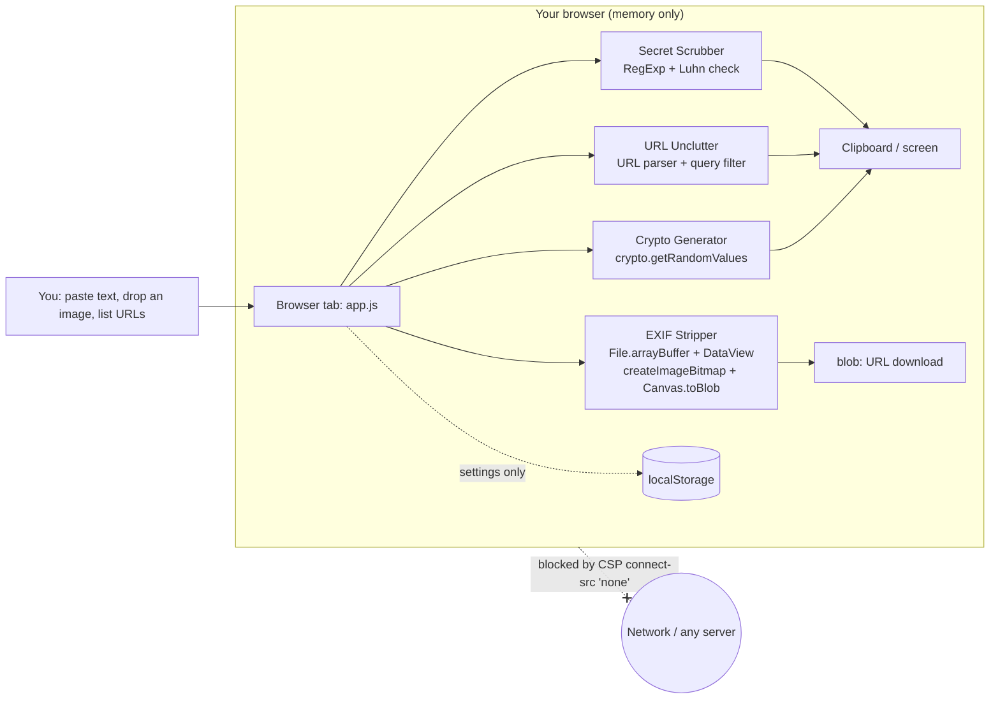

<div align="center">

# 🛡️ PrivacyShield Studio

### Sanitize before you share.

**Scrub API keys & PII before pasting into AI, strip hidden GPS from photos, clean tracking links, and mint crypto-grade secrets, all inside your browser tab.**

[](LICENSE)
[](https://reseachrandomv.github.io/privacy-shield-studio/)
[](#-architecture)
[](#-quick-start)
[](#-privacy-guarantee)
[](https://github.com/reseachrandomv/privacy-shield-studio/stargazers)
[](#-contributing)

**[🚀 Open the live app →](https://reseachrandomv.github.io/privacy-shield-studio/)**

</div>

<p align="center">
  <a href="https://reseachrandomv.github.io/privacy-shield-studio/">
    
  </a>
</p>

<p align="center">
  <br>
  <sub>Fully responsive: the same app on a 390 px phone</sub>
</p>

<p align="center">
  ⭐ <b>If PrivacyShield Studio keeps a secret out of an AI chat, please <a href="https://github.com/reseachrandomv/privacy-shield-studio">star the repo</a>.</b> It's free, takes one click, and helps other people find it.
</p>

---

## 🤔 The problem

Every day, people leak sensitive data without noticing:

- 🔑 **Pasting logs, `.env` files or stack traces into ChatGPT, Claude or Grok**, along with the API keys, emails, IPs and tokens inside them.
- 📍 **Sharing phone photos** that carry EXIF metadata: GPS coordinates, camera make and model, and capture timestamps.
- 🕵️ **Forwarding links** stuffed with `utm_*`, `fbclid`, `gclid`, `igshid` and other trackers that tie clicks back to you.
- 🎲 **Making up "random" passwords and secrets** by hand, or with tools built on `Math.random()`.

Most online "cleaners" fix this by asking you to **upload the very data you're trying to protect** to their server.

## ✅ The solution

**PrivacyShield Studio does everything locally.** It's a static page: three files (`index.html`, `styles.css`, `app.js`) with no backend, no analytics, no cookies and no upload endpoint. Your text, images and links are processed in memory by native browser APIs and never sent anywhere. The page's Content-Security-Policy sets `connect-src 'none'`, so the browser itself blocks any `fetch`, XHR, WebSocket or beacon the page might try.

---

## ✨ Features

| Module | What it does | Highlights |
|---|---|---|
| 🧹 **AI Prompt & Code Secret Scrubber** | Replaces secrets and PII in pasted text with clean placeholders such as `[REDACTED_EMAIL]` | Live output as you type · 7 toggleable rule groups · per-type counters ("3 Emails, 6 API Keys Scrubbed") · one-click sample leak data · copy with toast · rule toggles remembered |
| 🖼️ **EXIF & GPS Metadata Stripper** | Inspects JPEG / PNG / WebP bytes for metadata, then re-encodes through an offscreen `<canvas>` | Shows decoded GPS coordinates, camera and capture date · lists EXIF, JFIF, XMP, ICC, PNG text and GPS segments · PNG / JPEG / WebP export with 10–100% quality · before/after size badge · **re-inspects the output bytes to verify it's clean** · drag-and-drop, file picker or paste |
| 🔗 **Bulk URL Unclutter** | Strips tracking parameters from up to 50 links at once with the native `URL()` parser | 120 known trackers plus 5 tracker prefixes · per-link diff with removed-parameter chips · keeps functional parameters and their original encoding · flags invalid / non-http(s) links · copy all or copy one |
| 🔐 **Cryptographic Generator** | Passwords, diceware-style passphrases and API secrets from `crypto.getRandomValues()` | Rejection sampling (no modulo bias) · live entropy in bits, crack-time estimate and colour-coded strength meter · hide/show · last 5 results kept (masked, in memory only) |

---

## 🏗️ Architecture

No framework, no bundler, no npm packages. The page loads Tailwind CSS (Play CDN), Lucide icons (unpkg) and the Inter / JetBrains Mono fonts (Google Fonts). Those are the only network requests, and none of them carry your data.



### Web APIs doing the work

| API | Used for |
|---|---|
| **`RegExp`** (incl. lookbehind) | Detecting and replacing secrets and PII in the scrubber |
| **`File.arrayBuffer()` + `DataView`** | Parsing JPEG markers, PNG chunks, WebP RIFF chunks and TIFF/EXIF IFDs byte by byte |
| **`createImageBitmap()` + `<canvas>` `toBlob()`** | Decoding (with EXIF orientation applied) and re-encoding the image without any metadata |
| **`URL` / `URL.createObjectURL()`** | Parsing links for the tracker stripper, and creating local `blob:` URLs for previews and downloads |
| **`crypto.getRandomValues()`** | All randomness in the generator: the OS-level CSPRNG, never `Math.random()` |
| **`navigator.clipboard`** | Copy buttons (with a `document.execCommand('copy')` fallback) |
| **Content-Security-Policy** | `connect-src 'none'; form-action 'none'; frame-src 'none'; worker-src 'none'; object-src 'none'`, with scripts limited to the page itself, the two CDNs and one hashed inline config |

---

## 🔒 Privacy guarantee

- **No data leaves the tab.** Text, images, URLs and generated secrets exist only in page memory.
- **The browser enforces it.** `connect-src 'none'` in the CSP blocks network APIs at the browser level, even if the code wanted to call them.
- **Nothing sensitive is stored.** `localStorage` holds only UI settings: the active tab, redaction-rule toggles, image format/quality and generator options. Your input, images and generated secrets are never written to storage. Generator history lives in memory and disappears on reload.
- **Downloads are local.** Cleaned images are saved through a temporary `blob:` URL that is revoked afterwards.

### Verify it yourself in DevTools

1. Open the [live app](https://reseachrandomv.github.io/privacy-shield-studio/), then open DevTools (`F12`, or `⌘` `⌥` `I` on macOS) and go to the **Network** tab.
2. Once the page has finished loading (HTML, CSS, JS, Tailwind, Lucide and fonts), click 🚫 **Clear**.
3. Paste secrets, drop a photo, clean URLs and generate keys.
4. Watch the log: no new requests to any server. Only local `blob:` URLs appear, for image previews and downloads.
5. Go further: set throttling to **Offline**, or disconnect Wi-Fi. The already-loaded page keeps working.
6. Curious about a file? Run `PrivacyShield.inspectBytes(await file.arrayBuffer())` in the console to see what the parser finds.

> The tools need no network after the first load, but there's no service worker, so the page itself must be loaded online first.

---

## 🕵️ What gets detected

### Secret scrubber rules

Rules are applied in this order, so large structures such as key blocks are removed before broader patterns could match their fragments.

| Rule (toggle) | Placeholder | Detects |
|---|---|---|
| Private SSH/RSA keys | `[REDACTED_PRIVATE_KEY]` | PEM `-----BEGIN … PRIVATE KEY-----` blocks (RSA, EC, DSA, OPENSSH, ENCRYPTED, PGP `PRIVATE KEY BLOCK`…) and PuTTY `.ppk` keys |
| Bearer tokens & JWTs | `[REDACTED_TOKEN]` | `Bearer …` / `Token …` credentials (the keyword is kept for context) and three-part JWTs (`eyJ….eyJ….…`) |
| API keys | `[REDACTED_API_KEY]` | OpenAI `sk-` / `sk-proj-` / `sk-svcacct-` / `sk-admin-` · Anthropic `sk-ant-` · GitHub `ghp_` `gho_` `ghu_` `ghs_` `ghr_` and `github_pat_` · AWS access key IDs `AKIA` / `ASIA` / `ABIA` / `ACCA` and `aws_secret_access_key = …` values · Google `AIza…` · Slack `xox[baprse]-` · Stripe `sk_live_` / `sk_test_` / `rk_…` · GitLab `glpat-` · Hugging Face `hf_` · xAI `xai-` |
| Credit cards | `[REDACTED_CARD]` | 13–19-digit numbers (spaces or dashes allowed) that **pass the Luhn checksum** |
| Email addresses | `[REDACTED_EMAIL]` | Standard `name@domain.tld` addresses |
| IPv4 & IPv6 | `[REDACTED_IP]` | Dotted-quad IPv4 (each octet 0–255) and full or compressed (`::`) IPv6 |
| Phone numbers | `[REDACTED_PHONE]` | International and local formats such as `+1 (415) 555-0132`, `+960 777-1234` or `+14155550132` (7–15 digits, ISO dates excluded) |

> Regex detection is a strong safety net, not a guarantee. Always skim the sanitized output before you share it.

### EXIF stripper: what it inspects

Select or drop multiple images to clean them one at a time with your current export settings. Batch results list each file, the identifying metadata removed, and a separate download for each verified clean copy. Select one image for the detailed inspection and export settings.

| Format | Blocks reported |
|---|---|
| JPEG | APP1 `Exif` (with GPS IFD, camera make/model, software, capture date), APP1 XMP (incl. extended XMP), APP0 JFIF/JFXX, APP2 ICC profile, APP13 IPTC/Photoshop, other APPn segments, comments |
| PNG | `eXIf`, `tEXt` / `zTXt` / `iTXt` text chunks, XMP in `iTXt`, `iCCP`, `tIME` |
| WebP | `EXIF`, `XMP `, `ICCP` RIFF chunks |

Notes from the code:
- **File size:** images over 60 MB are rejected.
- **Very large images:** browsers limit how big a canvas can be, so the encoder tries up to 100 MP / 16,384 px per side, then a mobile-safe 16.7 MP / 8,192 px, and tells you if it scaled the image down.
- **JPEG transparency:** JPEG exports fill transparent areas with white.
- **Unsupported formats:** if your browser can't encode the chosen format (e.g. WebP), it saves in the format the browser produced and shows a warning.

### Tracking parameters removed

Matching is case-insensitive. Only these keys are removed; every other parameter and the path stay untouched, with their original encoding. Trackers hidden in the URL fragment (`#utm_source=…`) are cleaned too.

**Any key starting with:** `utm_` · `pk_` · `mtm_` · `hsa_` · `__hs`

<details>
<summary><b>All 120 named parameters</b> (click to expand)</summary>

`utm_source` `utm_medium` `utm_campaign` `utm_term` `utm_content` `utm_id` `utm_name` `utm_cid` `utm_reader` `utm_referrer` `utm_social` `utm_social-type` `utm_brand` `utm_place` `utm_pubreferrer` `utm_swu` `utm_viz_id` `fbclid` `gclid` `gclsrc` `dclid` `gbraid` `wbraid` `msclkid` `mc_cid` `mc_eid` `igshid` `igsh` `si` `ref` `ref_src` `ref_url` `_hsenc` `_hsmi` `__hssc` `__hstc` `__hsfp` `hsctatracking` `mkt_tok` `yclid` `ysclid` `twclid` `ttclid` `li_fat_id` `epik` `s_cid` `scid` `vero_id` `vero_conv` `wickedid` `oly_anon_id` `oly_enc_id` `rb_clickid` `_ga` `_gl` `spm` `trk` `trkcampaign` `sc_campaign` `sc_channel` `sc_content` `sc_medium` `sc_outcome` `sc_geo` `sc_country` `cmpid` `icid` `ncid` `irclickid` `irgwc` `xtor` `at_medium` `at_campaign` `wt_mc` `wt.mc_id` `mbid` `zanpid` `srsltid` `fb_action_ids` `fb_action_types` `fb_ref` `fb_source` `action_object_map` `action_type_map` `action_ref_map` `gad_source` `gad_campaignid` `nb_klid` `ml_subscriber` `ml_subscriber_hash` `pk_campaign` `pk_kwd` `pk_source` `pk_medium` `pk_content` `mtm_campaign` `mtm_keyword` `mtm_source` `mtm_medium` `mtm_content` `mtm_cid` `mtm_group` `mtm_placement` `hsa_acc` `hsa_cam` `hsa_grp` `hsa_ad` `hsa_src` `hsa_tgt` `hsa_kw` `hsa_mt` `hsa_net` `hsa_ver` `ss_source` `ss_campaign_id` `sms_ss` `smid` `smtyp` `share_source` `share_medium`

</details>

URL rules:
- **Limit:** only the first 50 lines are processed.
- **Allowed links:** only `http:` / `https:`. `javascript:`, `ftp:`, links containing spaces and other malformed lines are flagged **Invalid**.
- **Bare domains:** links without a scheme, like `www.example.com/page`, get `https://` added.

> Heads-up: `ref` and `si` are on the list because they're widely used for tracking (e.g. YouTube and Spotify `si=`). On the rare site that uses them functionally, re-add them by hand.

---

## 🎲 Entropy & strength scale

| Mode | Options | Entropy |
|---|---|---|
| **Password** | Length 8–128 (default 24) · uppercase / lowercase / digits / symbols `!@#$%^&*()-_=+[]{};:,.<>/?~` · exclude ambiguous (`0` `O` `o` `1` `l` `I` `\|`, quotes and `; : , .`) | `length × log2(pool size)`. Each selected set appears at least once (when length allows). |
| **Passphrase** | 3–12 words (default 8) from the 1,296-word EFF list · separator `-` `.` `_` space, none, or a random digit/symbol · capitalize · append a number 0–99 | `words × log2(1296)` ≈ 10.34 bits/word, + `log2(21)` per random separator, + `log2(100)` for the number |
| **API secret** | 16 / 32 / 64 random bytes · hex, Base64 or Base64url (unpadded) | `bytes × 8` → 128 / 256 / 512 bits |

The **strength label and the crack time come from the same number**: the average time to brute-force the secret offline (half the keyspace at **10¹² guesses per second**). So they can never disagree.

| Label | Average crack time | Roughly |
|---|---|---|
| 🔴 Very weak | under 1 second ("Instantly") | < 41 bits |
| 🟠 Weak | under 1 month | < 62 bits |
| 🟡 Fair | under 100 years | < 72 bits |
| 🟢 Strong | under 1 million years | < 86 bits |
| 💎 Excellent | 1 million years or more | ≥ 86 bits |

---

## 🚀 Quick start

### Use it online

👉 **https://reseachrandomv.github.io/privacy-shield-studio/**

### Run it locally

```bash
git clone https://github.com/reseachrandomv/privacy-shield-studio.git
cd privacy-shield-studio
# Option A: just open index.html in your browser
# Option B: serve it (enables the modern Clipboard API on localhost)
python3 -m http.server 8080   # then visit http://localhost:8080
```

There's no install, no `npm`, no build. The first load needs internet for Tailwind, Lucide and the fonts.

### Host your own copy (fork + GitHub Pages)

1. Click **Fork** at the top of this page.
2. In your fork, go to **Settings → Pages**.
3. Under **Build and deployment**, choose **Deploy from a branch**, then **`main`**, **`/ (root)`**, then **Save**.
4. After a minute, your copy is live at `https://<your-username>.github.io/privacy-shield-studio/`.

> If you edit the inline `tailwind.config` script in `index.html`, update its `sha256-…` hash in the CSP `<meta>` tag or the browser will block it.

---

## ⌨️ Keyboard & accessibility

| Shortcut | Action |
|---|---|
| `Alt` + `1` / `2` / `3` / `4` | Switch to Scrubber / EXIF / URLs / Crypto |
| `←` `→` `Home` `End` | Move between tabs (roving focus) |
| `←` `→` `↑` `↓` | Move between generator modes |
| `Ctrl` / `⌘` + `Enter` in the scrubber input | Copy the clean prompt |
| `Ctrl` / `⌘` + `Enter` in the URL box | Clean URLs |
| `Enter` / `Space` on the drop zone | Open the file picker |
| `Ctrl` / `⌘` + `V` on the EXIF tab | Paste an image from the clipboard |
| `Esc` | Close the privacy dialog |

- **Screen-reader semantics:**
  - Tabs use `role="tablist"` / `tab` / `tabpanel` with `aria-selected`.
  - Generator modes use `role="radiogroup"` with `aria-checked`.
  - The strength bar is a `role="meter"` with `aria-valuenow` / `aria-valuetext`.
- **Privacy dialog:** `aria-modal` with a Tab / Shift+Tab focus trap, `Esc` or backdrop to close, and focus returned to the trigger.
- **Announcements:** toasts and counters use `aria-live` regions.
- **Navigation and focus:** a skip-to-content link, visible `:focus-visible` rings on every control, and tap targets of at least 32 px.
- **Motion and contrast:** `prefers-reduced-motion` turns off animations, and `forced-colors` (high-contrast mode) is supported.
- **Responsive:** layouts for desktop, tablet and phone (tested at 1440, 768, 390 and 320 px).

---

## 🌐 Browser support

Built for current evergreen browsers: **Chrome / Edge, Firefox and Safari 16.4+**. The scrubber relies on RegExp lookbehind, which older Safari versions don't support. WebP export depends on the browser's canvas encoder; if WebP isn't supported, the app tells you and saves in the format the browser produced. The Clipboard API requires HTTPS or `localhost`; elsewhere a fallback copy method is used.

---

## 🤝 Contributing

Contributions of all sizes are welcome: bug reports, ideas, docs, translations and code. New secret patterns, tracker parameters and metadata formats are especially valuable.

- 🟢 **New here?** Pick a [`good first issue`](https://github.com/reseachrandomv/privacy-shield-studio/labels/good%20first%20issue) or something marked [`help wanted`](https://github.com/reseachrandomv/privacy-shield-studio/labels/help%20wanted).
- 💬 **Have a question or idea?** Start a thread in [Discussions](https://github.com/reseachrandomv/privacy-shield-studio/discussions).
- 🐛 **Found a bug?** Use the [bug report form](https://github.com/reseachrandomv/privacy-shield-studio/issues/new/choose).
- 🔒 **Security issue?** Report it privately: see [SECURITY.md](SECURITY.md).

Read the [contributing guide](CONTRIBUTING.md) for the project principles, file layout and PR checklist. Everyone taking part follows our [Code of Conduct](CODE_OF_CONDUCT.md).

---

## 🙏 Credits

- **Passphrase word list:** [EFF Short Wordlist #1](https://www.eff.org/dice) (1,296 words) by the Electronic Frontier Foundation, licensed under [CC BY 3.0 US](https://creativecommons.org/licenses/by/3.0/us/).
- **Icons:** [Lucide](https://lucide.dev) (ISC License).
- **Styling:** [Tailwind CSS](https://tailwindcss.com) (MIT License).
- **Fonts:** [Inter](https://rsms.me/inter/) and [JetBrains Mono](https://www.jetbrains.com/lp/mono/) (SIL Open Font License), served by Google Fonts.

---

## 📄 License

Released under the [MIT License](LICENSE).

Copyright © 2026 **Fathimath Malaak Jaufar**

<div align="center">

**If PrivacyShield Studio saved you from a leak, give it a ⭐. It helps others find it.**

</div>
